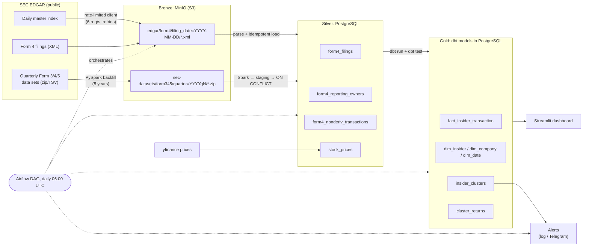
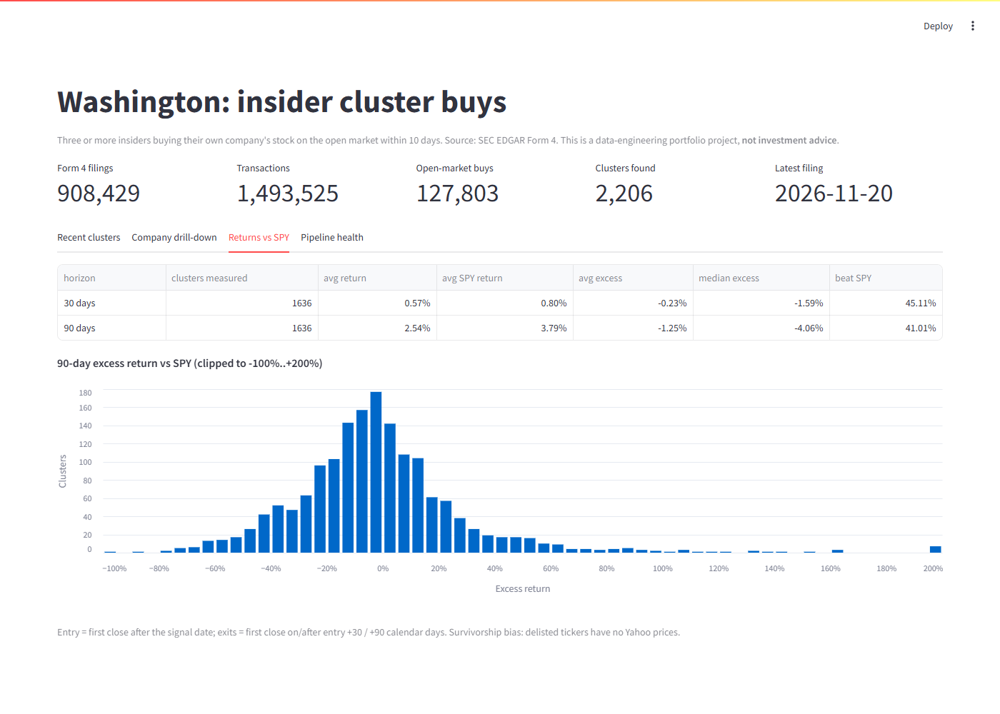

# Washington

**Insider cluster-buy detection pipeline on SEC EDGAR Form 4 data:** Airflow, PySpark, dbt,
PostgreSQL, MinIO, Streamlit. Runs entirely on one laptop with `docker compose`, at zero cost.

> ⚠️ **Not investment advice.** This is a data-engineering portfolio project. The returns
> analysis exists to show an end-to-end analytical pipeline, not to recommend trades.

---

## The problem

Company insiders (officers, directors, 10% owners) must report trades in their own company's
stock to the SEC on **Form 4** within two business days. One insider buying means little. But
when **several different insiders buy on the open market at about the same time**, it's a
signal that people watch: a **cluster buy**.

Washington turns the raw firehose of ~1,000 Form 4 filings a day into that signal:

> A **cluster buy** = **≥ 3 distinct insiders** of the same company making **open-market
> purchases** (transaction code `P`) within a **rolling 10-day window**, with total value
> **≥ $250,000**. All three thresholds are configurable in `.env`.

Every day it downloads new filings, keeps the raw XML, parses it into a warehouse, detects new
clusters, sends an alert, and measures how stocks did 30 and 90 days after historical clusters
compared with the S&P 500 (SPY).

## Architecture (Medallion: bronze → silver → gold)



**Daily DAG (`washington_daily`):**
`fetch_index → download_filings → parse_filings → load_silver → dbt_run → dbt_test →
detect_clusters → send_alerts`, plus `dbt_test → refresh_prices → dbt_returns`.
Each run processes exactly one filing date, so every step is idempotent and retry-safe.

## Tech stack and why

| Layer | Tool | Why this one (and not the alternative) |
|---|---|---|
| Orchestration | **Apache Airflow 2.10** (LocalExecutor) | Industry standard for batch DAGs; retries, backfills, pools and a UI out of the box. Chosen over cron (no retries or visibility) and Prefect/Dagster (less common in Indian DE job ads). 2.10 rather than 3.x because it's the version most teams still run; migration is a known follow-up. |
| Raw storage (bronze) | **MinIO** | S3-compatible, so the code would run unchanged on AWS S3. Free and local. Chosen over plain local files because it teaches the object-storage pattern every cloud lake uses. |
| Warehouse (silver/gold) | **PostgreSQL 16** | Free, strong SQL (window functions, `RANGE` frames, `ON CONFLICT`), and enough for ~1.5M rows. A cloud warehouse (BigQuery/Snowflake) would cost money; DuckDB is great but not a shared server for Airflow + dashboard. |
| Transformations | **dbt 1.10** | SQL models with tests, docs, lineage and incremental builds. Chosen over hand-written SQL scripts, which have no tests or dependency graph. |
| Historical backfill | **PySpark 3.5** (local mode) | Reads 20 quarterly zips of TSVs, types and windows them in parallel, writes via JDBC. Honestly, pandas could handle 1.5M rows; Spark shows the pattern that scales to bigger data. |
| Prices | **yfinance** | Free daily prices. No paid API key needed. |
| Serving | **Streamlit** | A full dashboard in one Python file. Superset/Metabase need their own server and metadata DB. |
| Quality | **pytest, ruff, dbt tests, GitHub Actions** | Unit + database integration tests, lint/format, data tests and a dbt unit test, all run in CI on every push. |

## Setup (under 10 commands)

Prerequisites: Docker Desktop (WSL 2 backend on Windows), Git. About 6 GB of disk for images.

```powershell
git clone https://github.com/Sanjay5704/Washington.git
cd Washington
Copy-Item .env.example .env        # then edit: SEC_USER_AGENT="Washington you@example.com" and passwords
docker compose up -d               # postgres, minio, airflow (init, webserver, scheduler), dashboard
docker compose --profile backfill run --rm spark-backfill     # 5 years of history (~7 min)
docker compose exec airflow-scheduler airflow dags backfill -s 2026-10-23 -e 2026-11-21T12:00:00 washington_daily
```

Then open:
- Airflow: <http://localhost:8080> (user/password from `.env`). Unpause `washington_daily` to run it daily.
- Dashboard: <http://localhost:8501>
- MinIO console: <http://localhost:9001>

Telegram alerts are off by default. To enable them, set `TELEGRAM_BOT_TOKEN` and `TELEGRAM_CHAT_ID` in `.env`.

Run the tests locally:

```powershell
pip install -e ".[dev]"; ruff check .; pytest        # add WASHINGTON_TEST_DB=1 + POSTGRES_* env vars for DB tests
```

## Data-quality checks

| Where | Check |
|---|---|
| EDGAR client | User-Agent with contact email is required; refuses ≥ 10 req/s; retries 429/5xx with exponential backoff and `Retry-After`. |
| Download / parse steps | Count every outcome (downloaded, already in bronze, missing, no XML, failed, parse errors) into `ops.ingest_audit`; a step **fails** if more than 2% of a day's items fail. |
| Silver | Natural primary keys `(accession_no)`, `(accession_no, owner_cik)`, `(accession_no, line_no)`; `CHECK` constraints; foreign keys from owners/transactions to filings; loads are `ON CONFLICT DO NOTHING`, so re-running a day changes nothing (proven by an integration test). |
| dbt generic tests | `unique`, `not_null`, `relationships` (fact → every dim), `accepted_values` (transaction codes, A/D, source), `unique_combination_of_columns` (custom). |
| dbt singular tests | clusters meet min insiders and min value; cluster dates are consistent; no overlapping clusters per company; purchases have positive value; returns are plausible (warns on split errors). |
| dbt unit test | Hand-made rows → exact expected clusters (3-in-window yes, 11-day gap no, too small no, one insider buying 3× no, two separate clusters for one company). |
| Fact model | `is_valid_transaction_date` flags trades dated after their filing or before 2000 (real typos like year 0202 exist); clusters ignore them. |

## Results from my run

Numbers below are from my own full run on a Windows 11 laptop (Docker Desktop, ~3.7 GB VM),
queried from the warehouse on 2026-11-24.

**Data loaded**

| | Filings | Reporting owners | Transaction lines |
|---|---:|---:|---:|
| PySpark backfill: SEC Form 3/4/5 data sets, 20 quarters (2021q2 to 2026q1) | 897,859 | 974,637 | 1,473,732 |
| Airflow daily DAG: 30 logical days, 2026-10-23 to 2026-11-21 (21 business days of filings) | 10,570 | 11,405 | 19,793 |
| **Total in silver** | **908,429** | **986,042** | **1,493,525** |

- The daily DAG ran **30 of 30 days successfully (300 task runs, 0 failed)**. 18 of those days
  had already run once before Docker Desktop crashed mid-backfill, so they ran a second time.
  17 loaded **0 new rows**, which shows the steps are idempotent. On the remaining day
  (2026-10-27) the first run had **1 failed download** (within the 2% tolerance). The re-run
  reused the 334 filings already in bronze, downloaded only the missing one and loaded it.
- The 2026q1 backfill matches SEC's own count of Form 4 filings for that quarter (56,853).
- `gold.fact_insider_transaction`: 1,493,525 rows, of which **127,803 are open-market purchases** (code `P`).
- Price history: 1,262,019 daily adjusted closes for 1,086 tickers (incl. SPY).
- `dbt build`: **57 passed, 1 warning, 0 errors** (data tests + 2 unit tests). The warning is
  5 transactions that have no transaction code in SEC's own data. `pytest`: **37 passed**
  (1 skipped locally because PySpark isn't installed outside Docker). `ruff`: clean.

**Clusters found** (≥ 3 insiders, code `P`, 10-day window, ≥ $250k)

- **2,206 clusters** across 1,290 tickers from 2021-04-01 to 2026-11-20.
- Average **4.63 insiders** per cluster; median cluster value **$1.13M**.
- **62 clusters** have a signal date inside the 30-day daily-DAG window; all were raised as
  alerts (logged, since Telegram is off by default).

**Returns vs SPY** (entry = first close after the signal date)

| Horizon | Clusters measured | Avg stock return | Avg SPY return | Avg excess | Median excess | Beat SPY |
|---|---:|---:|---:|---:|---:|---:|
| 30 days | 1,636 | +0.57% | +0.80% | **−0.23%** | −1.59% | 45.1% |
| 90 days | 1,636 | +2.54% | +3.79% | **−1.25%** | −4.06% | 41.0% |

Of the 2,206 clusters, 1,636 have both a 30-day and a 90-day result. The rest have no ticker
(180), no Yahoo price history (most are delisted companies), or are too recent: the
October–November 2026 clusters haven't had 30 days to play out yet.

**Honest reading:** in this sample, cluster buys did **not** beat the S&P 500 on average. The
median is worse than the mean, so a few big winners pull the average up. That's a perfectly
fine result for a data-engineering project: the pipeline measures the signal, and it
doesn't have to be a good signal. It is also biased (see limitations), so it isn't evidence
either way. **Not investment advice.**

## Dashboard

`docker compose up -d dashboard`, then open <http://localhost:8501>.

**Recent clusters** with filters, and clusters per month:


**Company drill-down**: every cluster for one company and each insider's open-market buys over time:


**Returns vs SPY**: summary table and the distribution of 90-day excess returns:



A fourth tab, **Pipeline health**, shows the per-day audit metrics from `ops.ingest_audit`.

## Known limitations and simplifications

- **Data gap from 2026-04-01 to 2026-10-22.** The quarterly data sets end at 2026q1 (SEC
  hadn't published 2026q2/q3 yet), and I only ran the daily DAG for the last 30 days. Running
  `airflow dags backfill` over the gap would fill it; I didn't, to keep the run short and
  polite to SEC.
- **Survivorship bias in returns.** Yahoo has no prices for many delisted companies, so
  failed companies are under-represented. Returns ignore trading costs and liquidity.
- **Joint filings:** one Form 4 can list several reporting owners. Each transaction is
  credited to one *primary* insider (lowest CIK), so a joint filing counts as one insider.
- **Form 4/A amendments are excluded.** Amended filings aren't merged with the originals.
- **Hand-typed tickers.** Issuers type the symbol themselves, so values like `NYSE: KRC` or
  `LEN, LEN.B` are cleaned in dbt (`macros/clean_ticker.sql`). Free text that can't be read
  safely becomes NULL, and multi-class issuers keep the first class listed.
- **5 transactions with no transaction code** in SEC's own data. The dbt test warns instead of failing.
- **`cluster_id` can change** if a late filing extends a cluster's window. Alerts go out only
  for clusters whose signal date is within the last 7 days, so old clusters aren't re-alerted.
- **Single machine.** Airflow LocalExecutor, PySpark in local mode, Postgres in Docker, sized
  for ~4 GB of Docker memory. Airflow 2.10, not 3.x.
- **MinIO image:** the official `minio/minio` image is no longer on Docker Hub, so I use
  `bitnamilegacy/minio`. It's S3-compatible, so swapping in AWS S3 or another image only
  changes `docker-compose.yml`.
- **Telegram alerts are wired but untested** against a real bot (no token was set). Alerts
  were logged instead.

## License

[MIT](LICENSE)

## How this was built

This project was built with **Claude Code** (an AI coding assistant) working from my
specification, and reviewed by me. The design decisions, bugs hit during the real run and their
fixes are written up in [LEARNING.md](LEARNING.md), which I use to prepare for interviews.
