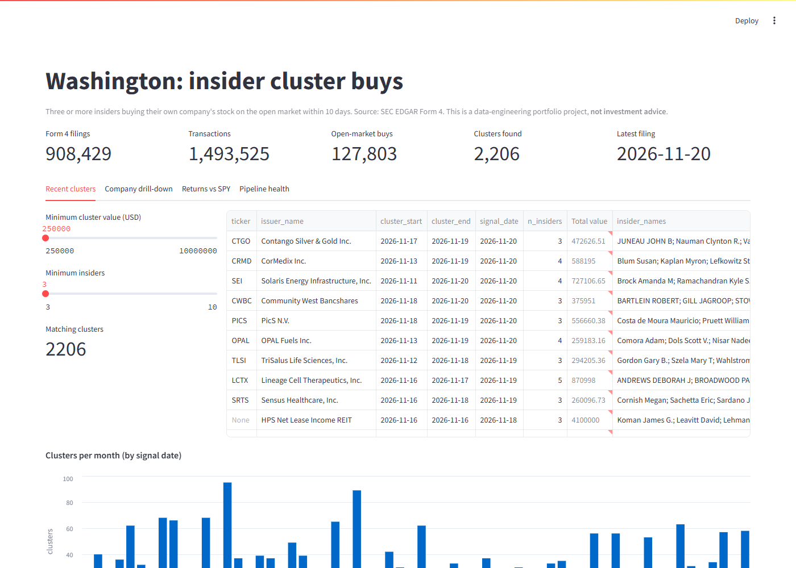
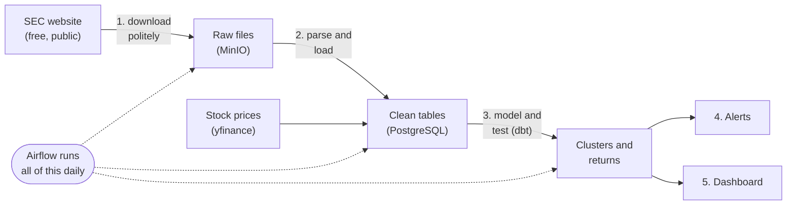
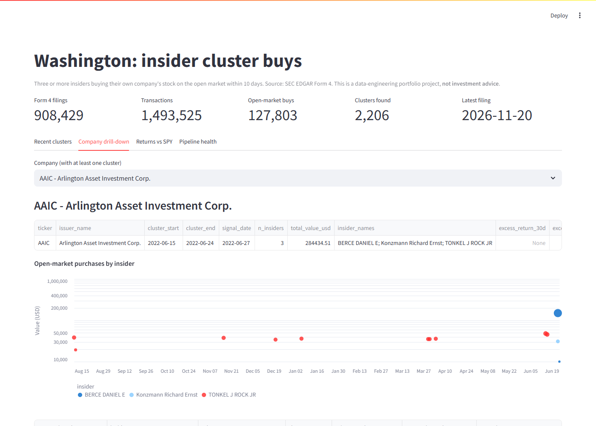

# Washington

[](https://github.com/Sanjay5704/Washington/actions/workflows/ci.yml)


**A data pipeline that spots when several company insiders buy their own company's stock at
the same time, using free public SEC filings.**

Built with Airflow, PySpark, dbt, PostgreSQL, MinIO and Streamlit. Runs on one laptop with
Docker, at zero cost.

> ⚠️ **Not investment advice.** This is a data-engineering portfolio project. It measures a
> well-known market signal; it does not recommend buying or selling anything.



---

## Contents

- [The idea in plain English](#the-idea-in-plain-english)
- [Results at a glance](#results-at-a-glance)
- [How it works](#how-it-works)
- [For interviewers: what's worth a look](#for-interviewers-whats-worth-a-look)
- [Tech stack and why](#tech-stack-and-why)
- [Run it yourself](#run-it-yourself)
- [Full results](#full-results)
- [Data-quality checks](#data-quality-checks)
- [Limitations](#limitations)
- [Glossary](#glossary)
- [How this was built](#how-this-was-built)

---

## The idea in plain English

In the US, a company's **insiders** (its directors, senior officers and biggest shareholders)
must publicly report whenever they buy or sell the company's own shares. They do it on a form
called **Form 4**, and it appears on the SEC's website within two business days.

One insider buying shares doesn't say much. They might just have spare cash. But when
**three or more different insiders all buy with their own money within a few days**, it can
mean the people who know the company best think the shares are cheap. Investors call this a
**cluster buy**.

About 1,000 Form 4s are filed every day, as raw XML files. Washington:

1. **collects** every Form 4 each day, plus five years of history,
2. **cleans and organises** them into a database,
3. **finds cluster buys** automatically,
4. **sends an alert** when a new one appears, and
5. **checks how the stock did** 30 and 90 days later compared with the overall market (the S&P 500).

**The rule it uses:** at least **3 different insiders** of the same company, each making an
**open-market purchase**, within **10 days**, adding up to at least **$250,000**. All three
numbers can be changed in one settings file.

## Results at a glance

From my own full run (numbers queried from the database on 2026-11-24):

| | |
|---|---|
| Form 4 filings processed | **908,429** (5 years: April 2021 to November 2026) |
| Individual transactions | **1,493,525**, of which **127,803** are open-market purchases |
| Cluster buys found | **2,206** across 1,290 companies |
| Typical cluster | 4.6 insiders, median $1.13M bought in total |
| Daily pipeline | **30 of 30 days ran successfully** (300 tasks, 0 failures) |
| Automated checks | 57 data checks pass in dbt (1 known warning), 37 code tests pass, CI green |

**Did following cluster buys beat the market?** In this sample, **no**. Over 90 days the stocks
returned +2.54% on average, against +3.79% for the S&P 500, which is **1.25 points worse**. Only 41%
of clusters beat the market. That's a fine outcome for this project: the job of a data
pipeline is to measure a signal correctly, not to prove that the signal works.
[Details below.](#full-results)

## How it works



The data moves through three layers, a common industry pattern called **medallion architecture**:

| Layer | Where | What's in it |
|---|---|---|
| **Bronze** (raw) | MinIO, an S3-compatible object store | The original XML files exactly as downloaded, so anything can be re-processed later |
| **Silver** (clean) | PostgreSQL | One row per filing, per insider and per transaction, with no duplicates |
| **Gold** (business-ready) | PostgreSQL, built by dbt | A star schema (`fact_insider_transaction` plus `dim_insider`, `dim_company` and `dim_date`), the `insider_clusters` table and the `cluster_returns` table |

**Two ways data gets in:**
- **History (once):** a **PySpark** job loads 20 quarters of the SEC's bulk Form 3/4/5 data
  sets, about 900k filings, in roughly 7 minutes.
- **Every day:** an **Airflow** workflow, which runs these steps in order:

  ```text
  fetch_index → download_filings → parse_filings → load_silver → dbt_run → dbt_test → detect_clusters → send_alerts
                                                                             └→ refresh_prices → dbt_returns
  ```

  Each run handles exactly one filing date, so any day can be re-run safely.

<details>
<summary><b>Detailed architecture diagram</b></summary>


</details>

## For interviewers: what's worth a look

These are the parts I'd point to in a technical discussion. Each one links to the code.

| Topic | What I did | Where |
|---|---|---|
| **Idempotent, re-runnable loads** | Natural primary keys, plus `INSERT … ON CONFLICT DO NOTHING`. Bronze skips files it already has. When Docker crashed mid-run, re-running 18 days added **0 duplicate rows**, and one day picked up exactly the 1 filing whose download had failed the first time. | [`silver.py`](src/washington/silver.py), [`pipeline.py`](src/washington/pipeline.py) |
| **Respecting an external API** | SEC allows at most 10 requests/second and requires a contact User-Agent. The client limits itself to 6/s, retries 429 and 5xx errors with exponential backoff, and honours `Retry-After`. A single-slot Airflow pool keeps the limit global across parallel runs. | [`edgar/client.py`](src/washington/edgar/client.py) |
| **Window-function SQL** | Cluster detection uses a rolling `RANGE` window, a distinct count via `array_agg` (Postgres can't `COUNT(DISTINCT)` inside a window), and gaps-and-islands with `LAG` and a running `SUM`. Every step is commented. | [`insider_clusters.sql`](dbt/models/marts/signals/insider_clusters.sql) |
| **Avoiding look-ahead bias** | The signal date is the date the *last qualifying filing became public*, not the trade date. Returns start the trading day after that. | same file, [`cluster_returns.sql`](dbt/models/marts/signals/cluster_returns.sql) |
| **Testing data, not just code** | dbt tests (unique, not null, relationships, accepted values, a custom composite-key test), singular business-rule tests, and **dbt unit tests** with hand-made rows for the cluster rules and ticker cleaning. | [`dbt/`](dbt/), [`tests/`](tests/) |
| **Performance debugging** | Found a step taking 13 minutes per day by querying Airflow's task durations. The cause was a materialised CTE hiding an index, and the fix brought it to **2 seconds**. Also used `EXPLAIN` to take a model from 163 s to 10 s. | [LEARNING.md](LEARNING.md) |
| **Real-world data mess** | SEC returns `403` for missing weekend files, the index lists each filing twice, tickers are hand-typed (`NYSE: KRC`, `(SIRI)`), and some dates have typos like year `0202`. Each one is handled and tested. | [LEARNING.md](LEARNING.md) |
| **Failures are visible** | Every step records counts to an audit table and fails if more than 2% of items fail. Airflow retries, then fires a failure callback. | [`washington_daily.py`](airflow/dags/washington_daily.py) |

[**LEARNING.md**](LEARNING.md) has the full story: for each stage, what was built and why, the
trickiest bug I hit, five interview questions with answers, and a line-by-line walkthrough of
the cluster SQL.

## Tech stack and why

| Job | Tool | Why this one |
|---|---|---|
| Scheduling and orchestration | **Apache Airflow 2.10** | Industry standard for batch pipelines, with retries, backfills, pools and a UI. Cron has no retries or visibility. |
| Raw file storage | **MinIO** | Speaks the same API as AWS S3, so the code would run on S3 unchanged. Free and local. |
| Database / warehouse | **PostgreSQL 16** | Free, has strong SQL (window functions, `ON CONFLICT`), and easily handles ~1.5M rows. A cloud warehouse would cost money. |
| Transformations and data tests | **dbt 1.10** | SQL models with tests, documentation, lineage and incremental builds. Hand-written SQL scripts have none of that. |
| Historical bulk load | **PySpark 3.5** | Reads 20 quarterly zip files in parallel. To be honest, pandas could handle this size; Spark shows the pattern that scales. |
| Stock prices | **yfinance** | Free daily prices, no API key needed. |
| Dashboard | **Streamlit** | A whole dashboard in one Python file. |
| Code quality | **pytest, ruff, GitHub Actions** | Unit and database tests, linting and `dbt parse` run on every push. |

## Run it yourself

You need **Docker Desktop** and **Git**, and about 6 GB of disk space.

```powershell
git clone https://github.com/Sanjay5704/Washington.git
cd Washington
Copy-Item .env.example .env        # then edit it: put your email in SEC_USER_AGENT, set passwords
docker compose up -d               # starts the database, storage, Airflow and the dashboard
docker compose --profile backfill run --rm spark-backfill     # loads 5 years of history (~7 min)
docker compose exec airflow-scheduler airflow dags backfill -s 2026-10-23 -e 2026-11-21T12:00:00 washington_daily
```

On macOS or Linux, use `cp .env.example .env` instead of `Copy-Item`.

Then open:
- **Dashboard:** <http://localhost:8501>
- **Airflow:** <http://localhost:8080> (login from `.env`). Switch on `washington_daily` to run it every day.
- **MinIO (raw files):** <http://localhost:9001>

Telegram alerts are off by default. To turn them on, set `TELEGRAM_BOT_TOKEN` and `TELEGRAM_CHAT_ID` in `.env`.

To run the tests:

```powershell
pip install -e ".[dev]"; ruff check .; pytest        # add WASHINGTON_TEST_DB=1 + POSTGRES_* env vars for the database tests
```

## Full results

All numbers come from my own run on a Windows 11 laptop (Docker with ~3.7 GB of memory).

<details open>
<summary><b>Data loaded</b></summary>

| Source | Filings | Insiders on filings | Transactions |
|---|---:|---:|---:|
| PySpark history load: 20 quarters, 2021q2 to 2026q1 | 897,859 | 974,637 | 1,473,732 |
| Airflow daily runs: 2026-10-23 to 2026-11-21 (21 business days) | 10,570 | 11,405 | 19,793 |
| **Total** | **908,429** | **986,042** | **1,493,525** |

- The 2026q1 load matches the SEC's own count of Form 4 filings for that quarter (56,853).
- Daily pipeline: **30 of 30 days succeeded** (300 task runs, 0 failed). Docker Desktop crashed
  partway through, so 18 days ran twice: 17 added **0 new rows**, and the other (2026-10-27)
  picked up exactly the 1 filing whose download had failed the first time.
- Prices: 1,262,019 daily closing prices for 1,086 tickers, including SPY.
- Checks: `dbt build` **57 passed, 1 warning, 0 errors**. The warning is 5 transactions with
  no transaction code in the SEC's own data. `pytest`: **37 passed** (1 skipped locally because PySpark
  only runs inside Docker). `ruff`: clean. CI is green on GitHub.

</details>

<details open>
<summary><b>Clusters found</b></summary>

- **2,206 cluster buys** across 1,290 companies, from 2021-04-01 to 2026-11-20.
- On average **4.63 insiders** per cluster; median total bought **$1.13M**.
- **62 clusters** appeared during the 30-day daily run, and each one triggered an alert (written to the log, since
  Telegram is off by default).

</details>

<details open>
<summary><b>Stock returns vs the S&P 500 (SPY)</b></summary>

Entry is the first closing price *after* the cluster became public. "Excess" means the stock's
return minus SPY's return over the same days.

| After | Clusters measured | Avg stock return | Avg S&P 500 return | Avg excess | Median excess | Beat the market |
|---|---:|---:|---:|---:|---:|---:|
| 30 days | 1,636 | +0.57% | +0.80% | **−0.23%** | −1.59% | 45.1% |
| 90 days | 1,636 | +2.54% | +3.79% | **−1.25%** | −4.06% | 41.0% |

1,636 of the 2,206 clusters have both results. The rest have no ticker (180), no price history
(mostly companies that no longer trade), or are too recent to have 30 days of prices yet.

**Honest reading:** in this sample, cluster buys did **not** beat the market on average. The
median is worse than the average, which means a few big winners pull the average up. The
results are also biased (see [limitations](#limitations)), so they aren't strong evidence either way.

</details>

**Dashboard screens.** The [screenshot at the top](#washington) shows the recent clusters. The
other tabs:

| Company drill-down | Returns vs the S&P 500 |
|---|---|
|  |  |

A fourth tab, **Pipeline health**, shows the daily audit counts.

## Data-quality checks

| Where | What's checked |
|---|---|
| Downloading | Contact User-Agent is required; the rate stays under SEC's limit; temporary errors are retried with backoff. |
| Each daily step | Every outcome is counted (downloaded, already stored, missing, failed, parse errors) into `ops.ingest_audit`. The step **fails** if more than 2% of the day's items fail. |
| Clean tables | Primary keys on natural IDs, `CHECK` constraints and foreign keys. Loads skip existing rows, so re-running a day changes nothing (an integration test proves it). |
| dbt column tests | `unique`, `not_null`, `relationships` (every fact row links to its dimensions), `accepted_values`, plus a custom composite-key test. |
| dbt business-rule tests | Every cluster has ≥ 3 insiders and ≥ the minimum value; cluster dates are consistent; clusters don't overlap; purchases have positive value; tickers look valid; returns are plausible. |
| dbt unit tests | Hand-made rows with known answers: 3 insiders in the window → cluster; an 11-day gap → none; too small → none; one insider buying 3 times → none; two separate clusters for one company. Also 10 messy tickers, mostly copied from real filings → the cleaned symbols. |
| Bad dates | Trades dated after their filing date, or before 2000 (real typos like year `0202` exist), are flagged and left out of clusters. |

## Limitations

- **Gap from April to 22 October 2026.** The SEC hadn't yet published those bulk quarters, and I
  only ran the daily pipeline for the last 30 days. Running the Airflow backfill over the gap would fill it.
- **Survivorship bias.** Free price data is missing for many companies that were later delisted, so
  companies that failed are under-counted. Returns also ignore trading costs.
- **Joint filings.** One Form 4 can list several owners (for example a fund and its manager). Each
  filing counts as one insider, the owner with the lowest SEC ID, so one filing can't fake a cluster.
- **Amendments (Form 4/A) are left out** rather than merged with the original filings.
- **Hand-typed tickers.** Text such as `NYSE: KRC` or `LEN, LEN.B` is cleaned to one symbol.
  Anything ambiguous becomes empty rather than risking a wrong match.
- **5 transactions with no transaction code** in the SEC's own data. The test warns instead of failing.
- **Cluster IDs can shift** if a late filing extends a cluster. Alerts only go out for clusters
  from the last 7 days, so old ones aren't re-sent.
- **Single machine.** Airflow LocalExecutor, Spark in local mode, sized for ~4 GB of Docker
  memory. It uses Airflow 2.10, not 3.x.
- **MinIO image.** The official `minio/minio` image is no longer on Docker Hub, so this uses
  `bitnamilegacy/minio`. It's S3-compatible, so swapping it is a one-line change.
- **Telegram alerts are wired up but untested** with a real bot. Alerts were written to the log instead.

## Glossary

| Term | Meaning |
|---|---|
| **SEC / EDGAR** | The US Securities and Exchange Commission, and its free public filing database. |
| **Form 4** | The form an insider files after trading their company's shares. |
| **Insider** | A director, senior officer or owner of more than 10% of a company. |
| **Open-market purchase (code `P`)** | Buying shares with their own money on the stock market, as opposed to receiving them as pay or through options. |
| **Cluster buy** | Here: 3+ different insiders making open-market purchases within 10 days, totalling $250k+. |
| **SPY** | A fund that tracks the S&P 500, used as "the market" for comparison. |
| **Excess return** | The stock's return minus the market's return over the same period. |
| **Pipeline / DAG** | An automated sequence of data steps. A DAG is Airflow's name for one. |
| **Idempotent** | Running it twice gives the same result as running it once, with no duplicates. |

## How this was built

This project was built with **Claude Code** (an AI coding assistant) working from my
specification, and I reviewed it. The design decisions, the real bugs hit while running it and
their fixes are written up in [LEARNING.md](LEARNING.md), which I use to prepare for interviews.

**License:** [MIT](LICENSE). **Not investment advice.**
